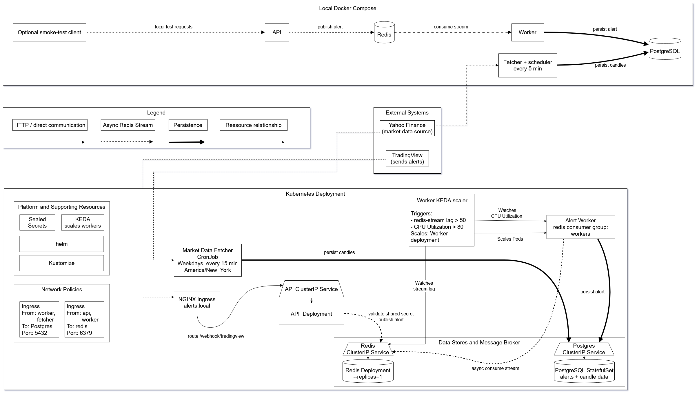

# Market Alerts

This project is a small, containerized backend for collecting and processing trading alerts and market data. A webhook API accepts TradingView alerts, validates a shared secret, and places valid alerts on a Redis stream. A worker consumes the stream and stores alerts in PostgreSQL. A separate fetcher retrieves market candle data and stores it in the same database.

The services are packaged with Docker, and the project supports both local Kubernetes deployments with Minikube or kind and cloud deployments on AWS. The Terraform for AWS deployments is managed separately in the [`market-alerts-infrastructure`](https://github.com/ralf-hermann-devops/market-alerts-infrastructure) repository.

## Table of contents

- [General architecture](#general-architecture)
- [Project structure](#project-structure)
- [Sending TradingView webhook alerts](#sending-tradingview-webhook-alerts)
- [Running the application stack locally](#running-the-application-stack-locally)
  - [Docker Compose](#docker-compose)
  - [Kubernetes in minikube or kind](#kubernetes-in-minikube-or-kind)
- [CI/CD and local testing](#cicd-and-local-testing)
- [Key technologies and implementation](#key-technologies-and-implementation)


## General architecture

TradingView sends alerts to the API, which validates each alert's shared secret and publishes valid alerts to a Redis stream. The worker consumes that stream and persists alerts to PostgreSQL. Independently, the market-data fetcher periodically retrieves candle data from Yahoo Finance and stores it in PostgreSQL.

The same services can run locally with Docker Compose or be deployed to Kubernetes. In Kubernetes, ingress routes webhook requests to the API, network policies constrain service access to Redis and PostgreSQL, KEDA scales the worker based on Redis stream lag and CPU utilization, and the bootstrap installs kube-prometheus-stack for monitoring.




## Project structure

- `services` — application code, Dockerfiles, and tests for each service.
    - `services/api/` — webhook API that validates and queues alerts.
    - `services/worker/` — consumes queued alerts and stores them in PostgreSQL.
    - `services/fetcher/` — retrieves market candle data and stores it in PostgreSQL.
    - `services/db/` — database initialization scripts.
- `k8s/` — everything needed to deploy and test the application on Kubernetes
    - `k8s/manifests/` — Kustomize resources for Kubernetes applications and environment overlays.
    - [`k8s/bootstrapping/`](k8s/bootstrapping/) — scripts to install configured Helm charts, bootstrap Sealed Secrets and create the encrypted manifest, plus image build-and-load helpers for Minikube and kind.
    - `k8s/tests/` — tests to exercise the application in a deployed Kubernetes cluster.
- `docs/` — project notes and architecture decision records.
    - See [`docs/architecture_decision_records/`](docs/architecture_decision_records/) for the rational behind architecturale decisions taken when building this repo
    - See [`docs/engineering_notes/`](docs/engineering_notes/) for further engineering notes on implementation and operational topics that do not have an architectural impact.
    - See [`docs/debugging_note.md`](docs/debugging_note.md) for an overview of how problems during development addressed.
    - See `docs/guides/` for guides and deep dives about certain aspects of the repository, including:
        - [`docs/guides/secret-bootstrap-flow.md`](docs/guides/secret-bootstrap-flow.md) — Describes in detail how the bootstrapping process for on-premise deployment with Sealed Secrets works
        - [`docs/guides/local-testing.md`](docs/guides/local-testing.md) — Describes how to run local testing
        - [`docs/guides/kubernetes-monitoring.md`](docs/guides/kubernetes-monitoring.md) — Describes the Kubernetes monitoring stack and Grafana dashboards.

## Sending TradingView webhook alerts

Send an HTTP `POST` request to `/webhook/tradingview` with a JSON body. The `secret`, `symbol`, and `action` fields are required, `price` and `timeframe` are optional. Set the `secret` to the same value as the API's `WEBHOOK_SECRET`.

```json
{
  "secret": "YOUR_WEBHOOK_SECRET",
  "symbol": "AAPL",
  "action": "long",
  "price": 210.5,
  "timeframe": "5m"
}
```


In TradingView, configure the alert message as this JSON and use the webhook URL for the running API. Supported action examples include `long`, `short`, and `close`.

TradingView requires a publicly reachable HTTPS webhook URL; `localhost` and private cluster services will not work. The on-premise overlay configures HTTPS for the placeholder host `alerts.example.invalid` and redirects HTTP requests to HTTPS. It uses a local certificate authority, so it is suitable only for local testing after you trust that authority on the calling machine. For the required local hostname mapping, certificate trust steps, and the later public DNS/ACME setup, see [the HTTPS webhook guide](docs/guides/https-webhook.md). Keep `WEBHOOK_SECRET` private.


## Running the application stack locally
### Docker Compose

Docker Compose starts the API, worker, fetcher, Redis, and PostgreSQL. Locally, the fetcher runs on a five-minute scheduler:

```bash
docker compose -f Dockercompose.yaml up --build
```

The API is available at `http://localhost:8000`. In Kubernetes, the fetcher image runs once per CronJob invocation instead; the CronJob schedules it every 15 minutes on weekdays. Local Compose credentials are for development only, do not use them in shared or production environments.


### Kubernetes in minikube or kind

The application is containerized and can also be deployed to a Kubernetes cluster. Kubernetes manifests are organized with Kustomize under `k8s/manifests/`, allowing shared configuration to be separated from environment-specific settings. A local cluster such as kind or Minikube can be used for testing, with cloud-specific configuration added when deploying to a platform such as Amazon EKS.

Before applying the Kubernetes manifests, build and load the application images with the helper for your cluster type. Each helper lists existing clusters and lets you select one or more, or create a new cluster by supplying a name. The scripts use Docker Compose to build the image names expected by the deployments:

```bash
# Minikube

# to see commandline options add --help to the script call
python k8s/bootstrapping/minikube_kind/minikube_build_and_load_images.py
```
or 
```bash
# kind

# to see commandline options add --help to the script call
python k8s/bootstrapping/minikube_kind/kind_build_and_load_images.py
```

To bootstrap a cluster, make sure `kubectl` points at the target cluster and `kubectl`, `kubeseal`, and Helm 3.17 or newer are available on your system's `PATH`.
Then run:

```bash
python k8s/bootstrapping/bootstrap_kubernetes_resources.py
```

The bootstrap script installs KEDA and kube-prometheus-stack from pinned Helm charts, installs the Sealed Secrets controller, prompts for application secret values, writes the encrypted SealedSecret manifest, and applies the selected overlay.
See the [secret bootstrap and deployment diagram](docs/guides/secret-bootstrap-flow.md) for the sequence and where decryption occurs.

## CI/CD and local testing

The `application-ci.yml` workflow runs on pushes and pull requests that change files under `services/`, `k8s/`, `Dockercompose.yaml`, or the workflow itself. It runs Ruff over the Python services, audits each service's Python dependencies, builds and scans the API, worker, and fetcher images for HIGH and CRITICAL vulnerabilities, runs the API unit tests plus the Docker-based worker smoke and API-to-worker integration tests, validates the base and on-premise Kubernetes manifests, and runs Kubernetes deployment smoke tests.

The Docker-based test scripts honor `COMPOSE_NO_REBUILD_IN_TESTS=1`. CI sets it so the tests reuse the service images built earlier in the test job. When run locally without that variable, the scripts build images as needed.


For instructions covering local application unit tests, Docker smoke and integration tests, and Kubernetes manifest and cluster tests, see the [local testing guide](docs/guides/local-testing.md).


## Key technologies and implementation

The FastAPI endpoint validates TradingView alerts and their shared secret, then publishes accepted alerts to a Redis stream. A separate worker consumes the stream and writes alerts to PostgreSQL, while the market-data fetcher retrieves candles with yfinance and stores them in the same database.

- **API metrics:** The API exposes Prometheus-formatted request counts and request-duration histograms at `/metrics`. The histogram uses finer bucket boundaries below 10 ms to distinguish the API's fast requests, plus wider buckets for slower outliers. Metrics use HTTP method, route template, and response status labels; the metrics scrape itself is excluded. The current Ingress only routes the webhook path, so `/metrics` is not externally exposed.
- **Application services:** Pydantic validates webhook data, redis-py and Psycopg connect the API and worker to Redis and PostgreSQL.
- **Local and cluster deployment:** Docker Compose runs the services locally. Kubernetes manifests use Kustomize overlays, with NetworkPolicies restricting service access, Sealed Secrets for application credentials, KEDA to scale the worker from queue load and CPU, and kube-prometheus-stack for Kubernetes and application monitoring.
- **Checks in CI:** pytest covers API behavior and Docker-based tests exercise the worker and API-to-worker flow. Ruff runs linting, pip-audit does dependency audits, and Trivy image scans provide additional vulnerability checks.
